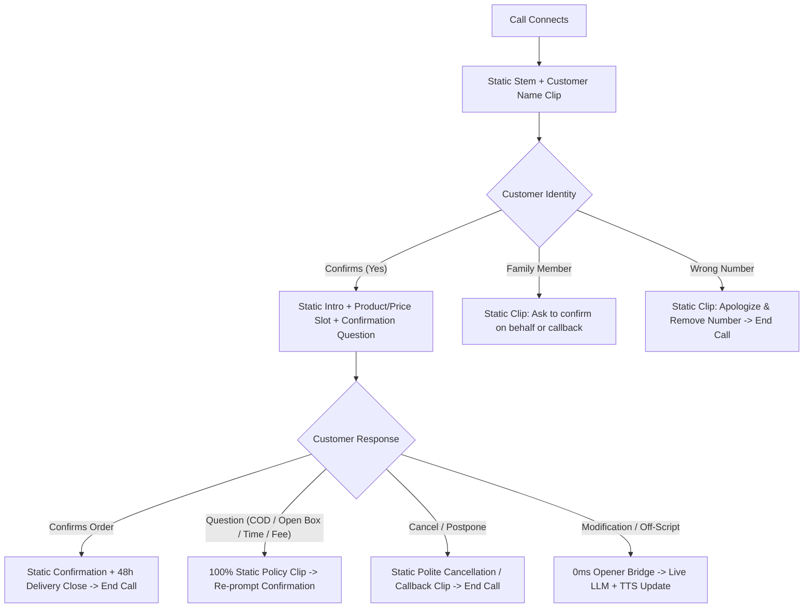

# Tunisian E-Commerce Order Confirmation (COD) — Voice AI Call Playbook & Recording Script Library

> **Purpose**: A production-ready call playbook and recording script library for Tunisian Cash-on-Delivery (COD) e-commerce order confirmation calls, engineered for **instant playback latency**, **natural Tunisian Derja**, and **minimal TTS/LLM generation cost**.

---

## Executive Summary: Hybrid Audio Architecture

Because e-commerce order confirmation calls follow a predictable structure, roughly **80%–90% of spoken audio** repeats identically across calls (greetings, policy answers, shipping timelines, confirmations, apologies, and goodbyes). Only a small fraction (customer name, product name, price, address, or custom modifications) changes per order.

Instead of paying LLM + TTS latency and API costs to regenerate the same sentences on every call, this architecture divides call audio into **three playback modes**:

| Playback Mode | How It Works | Perceived Latency | Cost |
| :--- | :--- | :--- | :--- |
| **`[100% STATIC CLIP]`** | Pre-recorded or pre-synthesized once and streamed straight from disk/memory cache. | **~0 ms** (Instant) | **\$0** per call |
| **`[STATIC STEM + DYNAMIC SLOT]`** | A pre-recorded audio prefix/suffix stitched seamlessly with a pre-generated or live dynamic variable (e.g., `[Customer Name]`, `[Product & Price]`, `[City]`). | **~0 ms – 50 ms** (when pre-cached before call dials) | Minimal (variables only) |
| **`[0ms OPENER BRIDGE + DYNAMIC LLM]`** | When a customer goes off-script (e.g., changes size/quantity or asks an unexpected question), a **0.8s–1.6s** pre-recorded bridge plays *immediately* as the user stops talking, masking the 1.2s–1.8s background LLM + TTS generation. | **< 200 ms** perceived response | Dynamic turn only |

---

## Part 1: Call Opening & Identity Verification (بداية المكالمة والتثبت من الهوية)

### Scenario 1: Standard Call Opening & Name Verification
**Trigger**: Call connects (`Start Call`).
**Playback Mode**: `[STATIC STEM + DYNAMIC SLOT]` *(Play Static Stem -> immediately stitch pre-generated `[Customer Name]` clip)*.

| Variant | Tone / Use Case | Tunisian Derja Script (For Recording / TTS) | Phonetic / Arabizi | English Meaning |
| :--- | :--- | :--- | :--- | :--- |
| **1A** | **Standard Warm** *(Recommended)* | **عسلامة، نهارك زين! معاك خدمة الحرفاء، بالله معاي** `[الاسم]`**؟** | *Aslema, nharek zin! M3ak khedmet el horafa, billahi m3aya `[Name]`?* | Hello, have a great day! Customer service here, am I speaking with `[Name]`? |
| **1B** | **Short & Direct** *(Fast-paced)* | **عسلامة، مرحبا بيك! بالله نتكلم مع** `[الاسم]`**؟** | *Aslema, marhba bik! Billahi netkallem m3a `[Name]`?* | Hello, welcome! Am I speaking with `[Name]`? |
| **1C** | **Formal / Respectful** | **السلام عليكم، سامحنا على الإزعاج، بالله معاي السيّد** `[الاسم]`**؟** | *Assalamu alaykum, samahna 3al iz3aj, billahi m3aya essayed `[Name]`?* | Peace be upon you, pardon the interruption, am I speaking with Mr. `[Name]`? |
| **1D** | **Ultra-Short Stem** *(1.1s clip)* | **عسلامة! معاي** `[الاسم]`**؟** | *Aslema! M3aya `[Name]`?* | Hello! Is `[Name]` with me? |

---

### Scenario 2: Customer Confirms Identity -> Transition to Order Recap
**Trigger**: Customer says *"إيه نعم"*, *"معاك"*, *"أنا هو"*, *"تفضل"*.
**Playback Mode**: `[STATIC STEM + DYNAMIC SLOT + STATIC QUESTION]`

| Variant | Part | Tunisian Derja Script (For Recording / TTS) | Phonetic / Arabizi | English Meaning |
| :--- | :--- | :--- | :--- | :--- |
| **2A (Part 1)** | **Static Intro Bridge** | **يعيشك ومرحبا بيك! نكلم فيك باش نثبتوا مع بعضنا الكوموند اللي عديتها عندنا.** | *Y3aychek w marhba bik! Nkallem fik bech nthabtou m3a b3adhna el commande elli 3additha 3andna.* | Thank you and welcome! I'm calling to verify the order you placed with us. |
| **2B (Part 1)** | **Fast Intro Bridge** | **مريقل يعيشك! جيست تثبيت صغير في الكوموند متاعك:** | *Mriguel y3aychek! Juste tathbit sghir fil commande mte3ek:* | Great, thank you! Just a quick verification of your order: |
| **2C (Part 2)** | **Dynamic Order Slot** | **عندك** `[المنتج والموديل]` **بـ** `[السوم الجملي]` **دينار بالتوصيل.** | *3andek `[Product & Variant]` b `[Total Price]` dinar bil tawsil.* | You have `[Product & Variant]` for `[Total Price]` DT including delivery. |
| **2D (Part 3)** | **Static Closing Question A** | **تحب نأكدوا الكوموند ونبعثوهالك؟** | *Theb n'akkdou el commande w nab3thouhalek?* | Would you like us to confirm the order and ship it to you? |
| **2E (Part 3)** | **Static Closing Question B** | **المعلومات الكل صحيحة؟ نأكدوا الكوموند؟** | *El ma3loumet el kol shiha? N'akkdou el commande?* | Is all the information correct? Shall we confirm the order? |

---

### Scenario 3: Wrong Person — Family Member / Spouse / Parent Answers
**Trigger**: Customer says *"لا، هذا تليفون ولدي / راجلي / مرتي / خويا"* or *"مووش هوني توا"*.
**Playback Mode**: `[100% STATIC CLIP]`

| Variant | Tone / Use Case | Tunisian Derja Script (For Recording / TTS) | Phonetic / Arabizi | English Meaning |
| :--- | :--- | :--- | :--- | :--- |
| **3A** | **Ask to Confirm on Their Behalf** | **مرحبا بيك! هو عدّى عندنا كوموند على النيميرو هذا، تنجم إنت تأكدهالنا في بلاصتو وإلا نعاودوا نكلموه مبعد؟** | *Marhba bik! Howa 3adda 3andna commande 3al numéro hedha, tnajjem enti t'akkedhelna fi blastou walla n3awdou nkallmouh mba3d?* | Welcome! They placed an order with this number—can you confirm it on their behalf, or should we call back later? |
| **3B** | **Ask When to Call Back** | **باهي ميسالش يعيشك، وقتاش نجموا نعاودوا نكلموه باش نأكدوا معاه الكوموند؟** | *Behi misalech y3aychek, waqtech najjmou n3awdou nkallmouh bech n'akkdou m3ah el commande?* | No problem at all, thank you. When can we call back to confirm the order with them? |
| **3C** | **Polite Exit After Family Defers** | **مريقل يعيشك، توا نعاودوا نكلموه في وقت آخر إن شاء الله. نهارك زين وبسلامة!** | *Mriguel y3aychek, tawa n3awdou nkallmouh fi waqt ekher inshallah. Nharek zin w bslama!* | Got it, thank you! We will call back at another time. Have a good day, goodbye! |

---

### Scenario 4: Wrong Number Completely — Never Placed an Order
**Trigger**: Customer says *"لا غالط في النيميرو"*, *"ما نعرفوش"*, *"ما عديت حتى كوموند"*.
**Playback Mode**: `[100% STATIC CLIP]`

| Variant | Tone / Use Case | Tunisian Derja Script (For Recording / TTS) | Phonetic / Arabizi | English Meaning |
| :--- | :--- | :--- | :--- | :--- |
| **4A** | **Standard Polite Apology** | **سامحنا برشا على الإزعاج! الظاهر فمّا شكون عدّى كوموند وحط النيميرو هذا بالغلط. توا نفسخوه من عندنا، نهارك زين وبسلامة!** | *Samahna barcha 3al iz3aj! Edhaher famma chkoun 3adda commande w hatt ennuméro hedha bil ghalat. Tawa nfasskhouh men 3andna, nharek zin w bslama!* | So sorry for the disturbance! Someone likely placed an order and typed this number by mistake. We'll remove it right away. Have a great day, goodbye! |
| **4B** | **Short & Courteous** | **أوكي سامحنا بالله، غلطة في النيميرو. يعيشك ونهارك مبروك، بسلامة!** | *Ok samahna billahi, ghalta fil numéro. Y3aychek w nharek mabrouk, bslama!* | Okay, pardon us, wrong number. Thank you and have a blessed day, goodbye! |
| **4C** | **Double-Check Household First** | **بالله ثبت معانا، ما فمّاش حد من الدار عدّى كوموند على الانترنات وحط نومروك؟** | *Billahi thabbet m3ana, ma fammech had mel dar 3adda commande 3al internet w hatt noumrouk?* | Just to be sure, did anyone in your household place an online order using your number? |

---

### Scenario 5: Guarded / Suspicious Customer ("Who is this? / What order?")
**Trigger**: Customer says *"شكون معاي؟"*, *"شنوة الكوموند هذي؟"*, *"منين جبتوا نومرويا؟"*.
**Playback Mode**: `[100% STATIC CLIP]` or `[STATIC STEM + DYNAMIC SLOT]`

| Variant | Tone / Use Case | Tunisian Derja Script (For Recording / TTS) | Phonetic / Arabizi | English Meaning |
| :--- | :--- | :--- | :--- | :--- |
| **5A** | **Clear & Reassuring** | **مرحبا بيك! إحنا خدمة الحرفاء، فمّا كوموند تعدّات على الباج متاعنا بالنيميرو هذا، ونكلموا فيك جيست باش نثبتوا قبل ما نبعثوها.** | *Marhba bik! Ehna khedmet el horafa, famma commande t3addet 3al page mte3na bil numéro hedha, w nkallmou fik juste bech nthabtou qbal ma nab3thouha.* | Welcome! We are customer support—an order was placed on our page with this number, and we're just calling to verify before shipping. |
| **5B** | **With Specific Product Reminder** | **عديت عندنا كوموند على الانترنات فيها** `[المنتج]`**، ونكلموا فيك باش نأكدوها معاك قبل التوصيل.** | *3addit 3andna commande 3al internet fiha `[Product]`, w nkallmou fik bech n'akkdouha m3ak qbal ettawsil.* | You placed an online order with us for `[Product]`, and we're calling to confirm it with you before delivery. |

---

## Part 2: Happy-Path Confirmation & Address Verification (التأكيد والتثبت من العنوان)

### Scenario 6: Customer Immediately Confirms Order ("إيه مريقل / أكد / ابعث")
**Trigger**: Customer confirms the order right away.
**Playback Mode**: `[100% STATIC CLIP]` *(If address is already clear -> closes call immediately)*.

| Variant | Tone / Use Case | Tunisian Derja Script (For Recording / TTS) | Phonetic / Arabizi | English Meaning |
| :--- | :--- | :--- | :--- | :--- |
| **6A** | **Standard Confirmation & Close** | **مريقل، الكوموند متاعك تأكدت! توصلك في ثمانية وأربعين ساعة إن شاء الله، والليفرور يكلمك قبل ما يخلط. يعيشك ونهارك زين، بسلامة!** | *Mriguel, el commande mte3ek t'akkdet! Tawslek fi thmenya w arb3in se3a inshallah, wel livreur ykallmek qbal ma yakhlet. Y3aychek w nharek zin, bslama!* | Great, your order is confirmed! It will reach you within 48 hours, and the courier will call you before arriving. Thank you, have a good day, goodbye! |
| **6B** | **Warm & Enthusiastic Close** | **يعيشك، قيدناها عندك! الكولي متاعك يخرج اليوم ويخلطلك في يومين على أقصى تقدير. رد بالك على تليفونك كي يكلمك الليفرور. مبروك مسبقاً وبسلامة!** | *Y3aychek, qayyedneha 3andek! El colis mte3ek yokhrej el youm w yakhletlek fi youmin 3la aqsa taqdir. Rod belek 3la talifounek ki ykallmek el livreur. Mabrouk mosbaqan w bslama!* | Thank you, we've logged it! Your parcel ships today and arrives within two days max. Keep an eye on your phone for the courier's call. Congrats in advance and goodbye! |
| **6C** | **Confirmation -> Transition to Address Check** | **مريقل، يعيشك! قبل ما نسكروا، خلينا نثبتوا مع بعضنا في العنوان باش الليفرور يلقاك بسهولة.** | *Mriguel, y3aychek! Qbal ma nsakkrou, khallina nthabtou m3a b3adhna fil 3onwen bech el livreur yalqak b souhoula.* | Great, thank you! Before we hang up, let's verify your address together so the courier finds you easily. |

---

### Scenario 7: Verifying Governorate, City & Landmark Address
**Trigger**: Need to confirm or clarify the delivery address in Tunisia (where landmarks are essential).
**Playback Mode**: `[STATIC STEM + DYNAMIC SLOT]` or `[100% STATIC CLIP]`

| Variant | Tone / Use Case | Tunisian Derja Script (For Recording / TTS) | Phonetic / Arabizi | English Meaning |
| :--- | :--- | :--- | :--- | :--- |
| **7A** | **Confirm Existing City/Address** | **العنوان المسجل عندنا هو** `[الولاية والمنطقة]`**، هكاكا الصحيح وإلا تحب نزيدوا تفصيل لليفرور؟** | *El 3onwen el msajjel 3andna howa `[City/Area]`, hakkeka esshih walla theb nzidou tafsil lil livreur?* | The address recorded with us is `[City/Area]`, is that correct or would you like to add details for the courier? |
| **7B** | **Ask for Missing Address / Landmark** | **بالله تنجم تعطيني العنوان متاعك بالضبط، الولاية والمنطقة وبحذا شنوة بالضبط باش الليفرور يخلطلك فيسع؟** | *Billahi tnajjem ta3tini el 3onwen mte3ek bedhabt, el wileya wel mantqa w bahdha chnowa bedhabt bech el livreur yakhletlek fisa3?* | Could you please give me your exact address—governorate, area, and a nearby landmark so the courier reaches you quickly? |
| **7C** | **Address Logged Confirmation** | **واضح ومريقل، قيدت العنوان بالضبط لليفرور، وهو ديجا يكلمك بالتليفون قبل ما يجي.** | *Wadhah w mriguel, qayyedt el 3onwen bedhabt lil livreur, w howa déja ykallmek bil talifoun qbal ma yji.* | Clear and noted! I've written the exact address for the courier, and he will also call your phone before arriving. |

---

## Part 3: Order Modifications (تبديل وتعديل الكوموند)

> **Latency Strategy**: When a customer asks to change size, color, quantity, or address, play the **`[0ms OPENER BRIDGE]`** first so they hear an instant human response while the LLM processes the change.

### Scenario 8: Customer Wants to Change Size, Color, or Model
**Trigger**: Customer says *"نحب نبدل التاي"*, *"نحب اللون الأكحل موش الرمادي"*, *"بدللي الموديل"*.
**Playback Mode**: `[0ms OPENER BRIDGE]` -> `[DYNAMIC LLM / STATIC CONFIRMATION]`

| Variant | Role | Tunisian Derja Script (For Recording / TTS) | Phonetic / Arabizi | English Meaning |
| :--- | :--- | :--- | :--- | :--- |
| **8A** | **0ms Opener Bridge (1.5s)** | **على عيني، ما فمّا حتى مشكل! لحظة برك نبدلهالك في السيستام...** | *3la 3ini, ma famma hatta mochkel! Lahdha bark nbaddelhalek fil système...* | Gladly, no problem at all! Just a second while I update it in the system... |
| **8B** | **Ask Which Size/Color They Want** | **مرحبا بيك، نجموا نبدلوها بطبيعة! أما تاي وأما لون تحب نقيدلك بالضبط؟** | *Marhba bik, najjmou nbaddlouha b tbi3a! Ama taille w ama loun theb nqayyedlek bedhabt?* | Welcome, of course we can change it! Which exact size and color would you like me to log for you? |
| **8C** | **Static Modification Confirmed** | **سي بون مريقل، بدلتلك الموديل في الكوموند كيما طلبت بالضبط. تحب نأكدوها على هكا؟** | *C'est bon mriguel, baddeltlek el modèle fil commande kima tlabt bedhabt. Theb n'akkdouha 3la hakka?* | All done! I updated the model in your order just as you requested. Shall we confirm it like this? |

---

### Scenario 9: Customer Wants to Change Quantity (Add or Remove Items)
**Trigger**: Customer says *"نحب نزيد كعبة أخرى"*, *"خليهم زوز"*, *"نقصلي كعبة، نحب وحدة برك"*.
**Playback Mode**: `[0ms OPENER BRIDGE]` -> `[DYNAMIC NEW TOTAL]`

| Variant | Role | Tunisian Derja Script (For Recording / TTS) | Phonetic / Arabizi | English Meaning |
| :--- | :--- | :--- | :--- | :--- |
| **9A** | **0ms Opener Bridge (1.4s)** | **مرحبا بيك! توا نعدلك العدد ونحسبلك السوم الجديد...** | *Marhba bik! Tawa n3addellek el 3adad w nahseblek essoum ejjdid...* | You're very welcome! Let me update the quantity and calculate the new total... |
| **9B** | **Confirm Updated Quantity Stem** | **مريقل، قيدتلك** `[العدد الجديد]` **كعبات، والسوم الجملي بالتوصيل يولي** `[السوم الجديد]` **دينار. نأكدوا على هكا؟** | *Mriguel, qayyedtlek `[New Qty]` ka3bet, w essoum el jomli bil tawsil ywalli `[New Total]` dinar. N'akkdou 3la hakka?* | Great, I logged `[New Qty]` items, and the new total with delivery is `[New Total]` DT. Shall we confirm? |

---

### Scenario 10: Customer Wants to Add a Backup Phone Number or Change Address
**Trigger**: Customer says *"نحب نبدل العنوان"*, *"زيد نومرو آخر خاتر تليفوني ساعات يطفي"*.
**Playback Mode**: `[100% STATIC CLIP]`

| Variant | Tone / Use Case | Tunisian Derja Script (For Recording / TTS) | Phonetic / Arabizi | English Meaning |
| :--- | :--- | :--- | :--- | :--- |
| **10A** | **Prompt for Secondary Phone Number** | **فكرة باهية! أعطيني النيميرو الثاني بالله، هاني نقيد فيه لليفرور باش كان ما خلطش عليك يكلمك عليه.** | *Fekra behya! A3tini ennuméro etheni billahi, hani nqayyed fih lil livreur bech ken ma khlatech 3lik ykallmek 3lih.* | Good idea! Give me the second number please, I'm noting it for the courier in case he can't reach your main line. |
| **10B** | **Prompt for New Delivery Address** | **مريقل، تفضل أعطيني العنوان الجديد بالضبط والولاية، هاني نسمع فيك.** | *Mriguel, tfadhal a3tini el 3onwen ejjdid bedhabt wel wileya, hani nasma3 fik.* | Got it, go ahead and give me the exact new address and governorate, I'm listening. |
| **10C** | **Confirm Info Updated** | **سي بون، قيدت المعلومة الجديدة في الدوسي متاعك. كل شي مريقل!** | *C'est bon, qayyedt el ma3louma ejjdida fil dossier mte3ek. Kol chay mriguel!* | All set, I saved the new information in your file. Everything is good to go! |

---

## Part 4: Delivery Logistics, Fees & Timeline Questions (التوصيل ومصاريف الشحن)

### Scenario 11: Customer Asks "When Will It Arrive?" ("وقتاش توصلني؟")
**Trigger**: Customer asks about delivery speed or arrival date.
**Playback Mode**: `[100% STATIC CLIP]`

| Variant | Tone / Use Case | Tunisian Derja Script (For Recording / TTS) | Phonetic / Arabizi | English Meaning |
| :--- | :--- | :--- | :--- | :--- |
| **11A** | **Standard 24h–48h Delivery** | **التوصيل ياخذ ما بين أربعة وعشرين وثمانية وأربعين ساعة إن شاء الله، وأول ما يجي الليفرور بحذاك يكلمك بالتليفون.** | *Ettawsil yekhedh ma bin arb3a w 3ichrin w thmenya w arb3in se3a inshallah, w awwel ma yji el livreur bahdhek ykallmek bil talifoun.* | Delivery takes between 24 and 48 hours, and as soon as the courier is near your area, he will call your phone. |
| **11B** | **Interior Governorates (48h–72h)** | **التوصيل يخلطلك في ما بين يومين وثلاثة أيام عمل إن شاء الله، وشركة التوصيل تكلمك قبل ما تجيك.** | *Ettawsil yakhletlek fi ma bin youmin w thletha ayyem 3amal inshallah, w chariket ettawsil tkallmek qbal ma tjik.* | Delivery reaches you within 2 to 3 business days, and the shipping company will call you before coming. |
| **11C** | **With Confirmation Follow-Up** | **تخرج الكوموند اليوم وتوصلك في ثمانية وأربعين ساعة إن شاء الله. مريقل نأكدوها؟** | *Tokhrej el commande el youm w tawslek fi thmenya w arb3in se3a inshallah. Mriguel n'akkdouha?* | The order ships today and reaches you in 48 hours. Shall we confirm it? |

---

### Scenario 12: Customer Requests a Specific Delivery Time or Work Address
**Trigger**: Customer says *"أنا نخدم الصباح، جيبوهالي العشية"*, *"نجموش نهار السبت؟"*, *"جيبوهالي للخدمة"*.
**Playback Mode**: `[100% STATIC CLIP]`

| Variant | Tone / Use Case | Tunisian Derja Script (For Recording / TTS) | Phonetic / Arabizi | English Meaning |
| :--- | :--- | :--- | :--- | :--- |
| **12A** | **Log Note for Courier** | **ما تحيرش، توا نحط ملاحظة على الكولي لشركة التوصيل، وكي يكلمك الليفرور تنجم تتفاهم معاه عالوقت والبلاصة اللي تساعدك.** | *Ma thayyerch, tawa nhott moulahdha 3al colis l chariket ettawsil, w ki ykallmek el livreur tnajjem tetfehem m3ah 3al waqt wel blasa elli tse3dek.* | Don't worry, I'll put a note on the parcel for the delivery company, and when the courier calls, you can coordinate the exact time and place that suits you. |
| **12B** | **Deliver to Workplace Instead** | **مريقل، نجموا نبعثوهالك لعنوان الخدمة متاعك باش تستلمها مرتاح. تحب تقيدلي عنوان الخدمة؟** | *Mriguel, najjmou nab3thouhalek l 3onwen el khedma mte3ek bech testlemha merteh. Theb tqayyedli 3onwen el khedma?* | Great, we can ship it to your workplace address so you can receive it comfortably. Would you like to give me your work address? |

---

### Scenario 13: Customer Asks About Delivery Cost ("قداش التوصيل؟ / التوصيل داخل في السوم؟")
**Trigger**: Customer asks if delivery is free or how much shipping costs.
**Playback Mode**: `[100% STATIC CLIP]` *(Choose the variant that matches your offer)*.

| Variant | Store Policy | Tunisian Derja Script (For Recording / TTS) | Phonetic / Arabizi | English Meaning |
| :--- | :--- | :--- | :--- | :--- |
| **13A** | **Delivery Included / Free** | **السوم اللي عطيتهولك هو السوم الجملي والنهائي، التوصيل داخل فيه، ما تزيد عليه شي!** | *Essoum elli 3tithoulek howa essoum el jomli wel nihe'i, ettawsil dekhel fih, ma tzid 3lih chay!* | The price I gave you is the final total price—delivery is already included, you don't pay anything extra! |
| **13B** | **Standard 7 DT Delivery Fee** | **التوصيل بسبعةلاف لكامل تراب الجمهورية، وكامل داخل في السوم الجملي اللي قلتهولك.** | *Ettawsil b sab3a lef l kemel toureb el jomhouriya, w kemel dekhel fil soum el jomli elli qolthoulek.* | Delivery is 7 DT anywhere in Tunisia, and it's already included in the total price I mentioned. |
| **13C** | **Standard 8 DT Delivery Fee** | **معلوم التوصيل ثمنية دينارات لكامل الولايات، حتى لباب الدار.** | *Ma3loum ettawsil thmanya dinarat l kemel el wileyet, hatta l beb eddar.* | The delivery fee is 8 DT across all governorates, right to your doorstep. |

---

### Scenario 14: Urgent Delivery Request ("حاجتي بيها غدوة باللي لازم / عندي مناسبة")
**Trigger**: Customer needs the item urgently for a birthday, wedding, travel, or gift.
**Playback Mode**: `[100% STATIC CLIP]`

| Variant | Tone / Use Case | Tunisian Derja Script (For Recording / TTS) | Phonetic / Arabizi | English Meaning |
| :--- | :--- | :--- | :--- | :--- |
| **14A** | **Priority Dispatch Assurance** | **على عيني! توا نعديهالك استعجالي وتخرج اليوم في أول فواياج مع شركة التوصيل باش تخلطلك في أقرب وقت إن شاء الله.** | *3la 3ini! Tawa n3addihalek isti3jeli w tokhrej el youm fi awwel voyage m3a chariket ettawsil bech takhletlek fi aqrab waqt inshallah.* | Gladly! I will mark it as urgent priority and dispatch it today in the first batch with the courier so it reaches you as fast as possible. |

---

## Part 5: Payment, Trust, Package Inspection & Warranty (الخلاص، التثبت من الكولي، والضمان)

### Scenario 15: Payment Method Question ("الخلاص عند الاستلام؟")
**Trigger**: Customer asks how payment works.
**Playback Mode**: `[100% STATIC CLIP]`

| Variant | Tone / Use Case | Tunisian Derja Script (For Recording / TTS) | Phonetic / Arabizi | English Meaning |
| :--- | :--- | :--- | :--- | :--- |
| **15A** | **Standard COD Reassurance** | **إيه بطبيعة، الخلاص عند الاستلام! ما تدفع حتى مليم توا، تخلص الليفرور كاش كي تاصل السلعة لباب دارك.** | *Ey b tbi3a, el khlas 3and el istilem! Ma tedfa3 hatta millim tawa, tkhalles el livreur cash ki tasel essel3a l beb darek.* | Yes of course, payment is Cash on Delivery! You don't pay a single millime now—you pay the courier cash when the item arrives at your door. |

---

### Scenario 16: "Can I Open the Package Before Paying?" ("نجم نحل الكولي قبل ما نخلص؟")
> **Note**: This is the **#1 customer question in Tunisian e-commerce**. Both policies below are provided so you can record the one matching your courier contract.

**Playback Mode**: `[100% STATIC CLIP]`

| Variant | Store / Courier Policy | Tunisian Derja Script (For Recording / TTS) | Phonetic / Arabizi | English Meaning |
| :--- | :--- | :--- | :--- | :--- |
| **16A** | **Policy A: Open & Inspect Allowed** | **إيه بطبيعة، من حقك تحل الكولي وتثبت في سلعتك قدام الليفرور قبل ما تخلص، باش تبدا مرتاح مية بالمية!** | *Ey b tbi3a, men haqqek thell el colis w tthabbet fi sel3tek qoddem el livreur qbal ma tkhalles, bech tebda merteh mya bil mya!* | Yes of course, you have the right to open the parcel and inspect your item in front of the courier before paying, so you have 100% peace of mind! |
| **16B** | **Policy B: Courier Rules Forbid Opening Before Payment (With Guarantee)** | **قانون شركات التوصيل في تونس ما يسمحش بحلان الكولي قبل الخلاص، أما كون هاني: الفاتورة ونومرو خدمة الحرفاء فوق الكولي، وكان فمّا أي حاجة نبدلوهالك فوراً!** | *Qanoun chariket ettawsil fi Tounes ma yasmahch b hallen el colis qbal el khlas, ama koun heni: el fatoura w noumrou khedmet el horafa fouq el colis, w ken famma ay haja nbaddlouhalek fawran!* | Courier company rules in Tunisia don't allow opening parcels before payment, but rest assured: our invoice and support number are on the box, and if there's any issue we exchange it immediately! |

---

### Scenario 17: Product Quality, Authenticity & Warranty ("السلعة أصلية؟ / فيها غارانتي؟")
**Trigger**: Customer asks *"السلعة كيما في التصويرة؟"*, *"فيها ضمان / غارانتي؟"*, *"حاجة باهية؟"*.
**Playback Mode**: `[100% STATIC CLIP]`

| Variant | Tone / Use Case | Tunisian Derja Script (For Recording / TTS) | Phonetic / Arabizi | English Meaning |
| :--- | :--- | :--- | :--- | :--- |
| **17A** | **Quality & Exact Photo Match** | **كون هاني، السلعة كاليتي ممتازة ومطابقة مية بالمية للي شفتها في الباج، ومثبتين فيها مليح قبل ما تخرج.** | *Koun heni, essel3a qualité momteza w moutabqa mya bil mya lilli choftha fil page, w mthabtin fiha mlih qbal ma tokhrej.* | Rest assured, the product is top quality, 100% identical to what you saw on the page, and carefully inspected before shipping. |
| **17B** | **With Official Warranty** | **إيه بطبيعة، السلعة أصلية وتجيك بالغارانتي متاعها والفاتورة، وخدمة الحرفاء متاعنا ديما على ذمتك.** | *Ey b tbi3a, essel3a asliya w tjik bil garantie mte3ha wel fatoura, w khedmet el horafa mte3na dima 3la dhemtek.* | Yes of course, the product is authentic and comes with its warranty and invoice, and our customer service is always at your disposal. |

---

### Scenario 18: Exchange & Return Policy ("وإذا ما جاتش قدي نجم نبدل؟")
**Trigger**: Customer worries about wrong fit or wanting to exchange later.
**Playback Mode**: `[100% STATIC CLIP]`

| Variant | Tone / Use Case | Tunisian Derja Script (For Recording / TTS) | Phonetic / Arabizi | English Meaning |
| :--- | :--- | :--- | :--- | :--- |
| **18A** | **Hassle-Free Exchange Assurance** | **ما تحيرش جملة! كان التاي ما جاتش قدك وإلا حبيت تبدل الموديل، تكلمنا على نفس النيميرو هذا ونبعثولك الليفرور يبدلهالك.** | *Ma thayyerch jemla! Ken ettaille ma jatech qaddek walla habbit tbaddel el modèle, tkallemna 3la nafs ennuméro hedha w nab3thoulek el livreur ybaddelhalek.* | Don't worry at all! If the size doesn't fit or you want to swap models, just call us on this number and we'll send the courier to exchange it for you. |

---

## Part 6: Objections, Hesitation, Postponement & Cancellation (الاعتراض، التأجيل، والإلغاء)

### Scenario 19: Price Objection / Asking for a Discount ("غالية شوية / ما تنقصليش؟")
**Trigger**: Customer says *"انقصلي شوية"*, *"اعمللنا سوم باهي"*, *"السوم غالي"*.
**Playback Mode**: `[100% STATIC CLIP]`

| Variant | Tone / Use Case | Tunisian Derja Script (For Recording / TTS) | Phonetic / Arabizi | English Meaning |
| :--- | :--- | :--- | :--- | :--- |
| **19A** | **Polite Value Defense (Fixed Promo Price)** | **والله يعيشك السوم هذاكا ديجا فيه بروموسيون خاصة، أما كون هاني السلعة حاجة نظيفة برشا وتستاهل، وإن شاء الله تعجبك!** | *Wallahi y3aychek essoum hedheka déja fih promotion khassa, ama koun heni essel3a haja ndhifa barcha w testehal, w inshallah ta3jbek!* | Honestly, that price already includes a special promotion, and rest assured the item is very high quality and well worth it—you'll love it! |
| **19B** | **Short & Friendly Fixed Price** | **والله السوم فيكس يعيشك خاتر ديجا حاسبينها بسوم البرومو، تحب نأكدوا الكوموند؟** | *Wallahi essoum fixe y3aychek khater déja hasbinha b soum el promo, theb n'akkdou el commande?* | The price is fixed, thank you, as it's already calculated at the promo rate. Shall we confirm the order? |

---

### Scenario 20: Customer Wants to Think About It or Postpone ("خليني نشاور / أجّلهالي للجمعة الجاية")
**Trigger**: Customer says *"خليني نشوف مع الدار ونرجعلك"*, *"خليهالي لأول الشهر كي تصب الشهريّة"*.
**Playback Mode**: `[100% STATIC CLIP]`

| Variant | Tone / Use Case | Tunisian Derja Script (For Recording / TTS) | Phonetic / Arabizi | English Meaning |
| :--- | :--- | :--- | :--- | :--- |
| **20A** | **Consult Family & Call Back Tomorrow** | **خذ راحتك بطبيعة! توا نخليلك الكوموند معلّقة في السيستام، ونعاودوا نكلموك غدوة إن شاء الله باش نشوفوا رايك. نهارك زين!** | *Khodh rahtek b tbi3a! Tawa nkhallilek el commande m3allqa fil système, w n3awdou nkallmouk ghodwa inshallah bech nchoufou rayek. Nharek zin!* | Take your time of course! I'll keep your order on hold in the system, and we'll call you back tomorrow to check your decision. Have a good day! |
| **20B** | **Schedule Delivery for Specific Future Date** | **مرحبا بيك، ما فمّا حتى مشكل! توا نقيدها عندك في السيستام باش نبعثوهالك في التاريخ اللي يساعدك بالضبط. نهارك مبروك وبسلامة!** | *Marhba bik, ma famma hatta mochkel! Tawa nqayyedha 3andek fil système bech nab3thouhalek fil tarikh elli yse3dek bedhabt. Nharek mabrouk w bslama!* | Welcome, no problem at all! I'll schedule it in the system so we ship it on the exact date that suits you. Have a blessed day, goodbye! |

---

### Scenario 21: Customer Cancels Order ("بطلت / ما عادش حاجتي / شريت من بلاصة أخرى")
**Trigger**: Customer wants to cancel the order completely.
**Playback Mode**: `[100% STATIC CLIP]`

| Variant | Tone / Use Case | Tunisian Derja Script (For Recording / TTS) | Phonetic / Arabizi | English Meaning |
| :--- | :--- | :--- | :--- | :--- |
| **21A** | **Graceful, Zero-Friction Cancellation** | **ما فمّا حتى مشكل يعيشك! توا نبطلوا الكوموند من السيستام، ومرحبا بيك عندنا في أي وقت آخر. نهارك زين وبسلامة!** | *Ma famma hatta mochkel y3aychek! Tawa nbattlou el commande mel système, w marhba bik 3andna fi ay waqt ekher. Nharek zin w bslama!* | No problem at all, thank you! We'll cancel the order in the system right away, and you're always welcome anytime. Have a great day, goodbye! |
| **21B** | **Gentle Check Before Canceling** | **على راحتك يعيشك! جيست نجم نعرف كان فمّا إشكال في السوم وإلا في وقت التوصيل نجموا نعاونوك فيه قبل ما نبطلوها؟** | *3la rahtek y3aychek! Juste najjem na3ref ken famma ichkel fil soum walla fi waqt ettawsil najjmou n3awnouk fih qbal ma nbattlouha?* | Totally up to you! May I just ask if there was an issue with the price or delivery timing that we could help solve before canceling? |

---

### Scenario 22: Duplicate Order ("راني عديت مرتين بالغلط، نحب كعبة برك")
**Trigger**: Customer placed the order twice on the website by mistake.
**Playback Mode**: `[100% STATIC CLIP]`

| Variant | Tone / Use Case | Tunisian Derja Script (For Recording / TTS) | Phonetic / Arabizi | English Meaning |
| :--- | :--- | :--- | :--- | :--- |
| **22A** | **Cancel Duplicate & Confirm Single Order** | **باهي اللي قلتلي يعيشك! توا نفسخ الكوموند المعاودة ونخليلك كعبة برك مؤكدة. توصلك في ثمانية وأربعين ساعة إن شاء الله!** | *Behi elli qoltli y3aychek! Tawa nfassakh el commande el m3awda w nkhallilek ka3ba bark m'akkda. Tawslek fi thmenya w arb3in se3a inshallah!* | Good thing you told me, thank you! I'll delete the duplicate order and keep just one confirmed for you. It will reach you in 48 hours! |

---

## Part 7: Conversation Control, Audio Issues & Special Edge Cases (إدارة المكالمة والحالات الخاصة)

### Scenario 23: Customer is Busy / Driving / At Work ("هاني نسوق / في الخدمة كلمني مبعد")
**Trigger**: Customer answers but cannot talk right now.
**Playback Mode**: `[100% STATIC CLIP]`

| Variant | Tone / Use Case | Tunisian Derja Script (For Recording / TTS) | Phonetic / Arabizi | English Meaning |
| :--- | :--- | :--- | :--- | :--- |
| **23A** | **Fast & Respectful Hang-Up** | **سامحنا على الإزعاج وربي يعاونك! توا نعاودوا نكلموك مبعد كي تبدا فاضي إن شاء الله. بسلامة!** | *Samahna 3al iz3aj w rabbi y3awnek! Tawa n3awdou nkallmouk mba3d ki tebda fadhi inshallah. Bslama!* | Sorry for the interruption and may God help you! We'll call you back later when you're free. Goodbye! |
| **23B** | **Quick 5-Second Confirmation Option** | **ربي يعاونك! كان الكوموند متاعك مريغلة قولي غير إيه ونبعثوهالك من غير ما نعطلك!** | *Rabbi y3awnek! Ken el commande mte3ek mrigla qolli ghir ey w nab3thouhalek men ghir ma n3attlek!* | May God help you! If your order is good to go, just say "yes" and we'll ship it without holding you up! |

---

### Scenario 24: Poor Audio / Silence / Unclear Speech ("آلو؟ / ما نسمعش فيك")
**Trigger**: Bad network, background noise, or customer silence.
**Playback Mode**: `[100% STATIC CLIP]`

| Variant | Tone / Use Case | Tunisian Derja Script (For Recording / TTS) | Phonetic / Arabizi | English Meaning |
| :--- | :--- | :--- | :--- | :--- |
| **24A** | **Customer is Silent / Still There Check** | **آلو؟ مزال معانا عالخط؟ تسمع فيا مليح؟** | *Allo? Mezel m3ana 3al khat? Tasma3 fiya mlih?* | Hello? Are you still with us on the line? Can you hear me well? |
| **24B** | **Unclear Audio / Ask to Repeat** | **سامحني بالله، الصوت تقطع شوية ما سمعتكش مليح، تنجم تعاودلي شنوة قلت؟** | *Samahni billahi, essout tqatta3 chwaya ma sma3tekch mlih, tnajjem t3awedli chnowa qolt?* | Pardon me, the audio cut out slightly and I didn't hear you clearly—could you repeat what you said? |
| **24C** | **Disconnect Due to Bad Line** | **الظاهر الريزو تاعب شوية والصوت موش واضح، توا نعاودوا نكلموك بعد شوية. بسلامة!** | *Edhaher eréseau te3eb chwaya w essout mouch wadhah, tawa n3awdou nkallmouk ba3d chwaya. Bslama!* | It looks like the network signal is weak and audio isn't clear—we'll call you back shortly. Goodbye! |

---

### Scenario 25: Customer Puts Agent on Hold ("اصبر لحظة نسأل في الدار / نشوف")
**Trigger**: Customer asks the agent to wait a moment.
**Playback Mode**: `[100% STATIC CLIP]`

| Variant | Tone / Use Case | Tunisian Derja Script (For Recording / TTS) | Phonetic / Arabizi | English Meaning |
| :--- | :--- | :--- | :--- | :--- |
| **25A** | **Patient Hold Acknowledgment** | **خذ راحتك، هاني معاك عالخط نستنى فيك.** | *Khodh rahtek, hani m3ak 3al khat nestanna fik.* | Take your time, I'm on the line waiting for you. |

---

### Scenario 26: Customer Asks "Are You an AI / Robot?" ("إنت روبو وإلا شكون يكلم فيا؟")
**Trigger**: Customer notices the voice assistant or asks directly.
**Playback Mode**: `[100% STATIC CLIP]`

| Variant | Tone / Use Case | Tunisian Derja Script (For Recording / TTS) | Phonetic / Arabizi | English Meaning |
| :--- | :--- | :--- | :--- | :--- |
| **26A** | **Friendly & Transparent Tunisian Response** | **إيه يعيشك، أنا المساعد الذكي متاع خدمة الحرفاء، نكلم فيك باش نربحوك في الوقت ونأكدولك الكوموند متاعك فيسع! مريقل نأكدوها؟** | *Ey y3aychek, ena el mousa3ed edhaki mte3 khedmet el horafa, nkallem fik bech nrebhouk fil waqt w n'akkdoulek el commande mte3ek fisa3! Mriguel n'akkdouha?* | Yes indeed, I'm the smart customer service assistant, calling to save you time and confirm your order quickly! Shall we confirm it? |
| **26B** | **Offer Human Callback If Requested** | **وكان تحب تكلم حد من الفريق متاعنا، توا نخلي ملاحظة ويعاود يكلمك مسؤول الحرفاء مباشرة.** | *W ken theb tkallem had mel fariq mte3na, tawa nkhalli moulahdha w y3awed ykallmek mas'oul el horafa moubachara.* | And if you'd like to speak with a team member, I'll leave a note and a support agent will call you directly. |

---

## Part 8: The "Zero-Latency Opener Bridge" Micro-Clip Library (مكتبة المقاطع القصيرة لكسر وقت الانتظار)

When a customer asks an unexpected or complex off-script question (requiring a live LLM + TTS turn), playing one of these **0.8s to 1.6s micro-recordings** right after they finish speaking makes the response feel **instantaneous (<200ms)** while the dynamic answer generates in the background:

| Clip ID | Category | Duration | Tunisian Derja Script | Phonetic / Arabizi | When to Trigger |
| :--- | :--- | :--- | :--- | :--- | :--- |
| **`BRIDGE_01`** | Positive Acknowledgment | ~0.9s | **يعيشك، مريقل!** | *Y3aychek, mriguel!* | Customer agrees or gives info |
| **`BRIDGE_02`** | Checking System / Order | ~1.5s | **باهي يعيشك، لحظة برك نثبتلك في السيستام...** | *Behi y3aychek, lahdha bark nthabbetlek fil système...* | Customer asks a product/order question |
| **`BRIDGE_03`** | Modifying / Updating | ~1.4s | **على عيني، هاني نقيد فيها عندك...** | *3la 3ini, hani nqayyed fiha 3andek...* | Customer gives address/change |
| **`BRIDGE_04`** | Answering a Question | ~1.2s | **سؤال باهي، توا نقلك بالضبط...** | *Sou'el behi, tawa nqollek bedhabt...* | Customer asks about policy/shipping |
| **`BRIDGE_05`** | Empathy / Understanding | ~1.3s | **فهمتك بالباهي، ما تحيرش...** | *Fhemtek bil behi, ma thayyerch...* | Customer expresses hesitation/concern |
| **`BRIDGE_06`** | Polite Transition | ~0.8s | **واضح يعيشك...** | *Wadhah y3aychek...* | General neutral bridge before LLM reply |

---

## Recommended Recording & Production Checklist

1. **Audio Format Match**: Record or export all clips at **24,000 Hz, 16-bit Mono PCM** (matching Punica `dido` TTS output) so stitched clips (`Static Stem` + `Dynamic TTS`) have zero sample-rate pop/click artifacts.
2. **Silence Trimming**: Trim leading silence to **`< 15 ms`** and trailing silence to **`~80 ms`** on all `Static Stems` (like *"عسلامة، معاي..."*) so the customer's name connects smoothly as one natural breath.
3. **Consistent Voice Persona**: Generate both the static library and the dynamic slots using the exact same `dido` voice ID (or record the top 50 Tunisian first names + top products with the same voice actor) for seamless transitions.
4. **Pre-Call Slot Pre-Warming**: Before dialing a batch of outbound orders, pre-synthesize only the variable slots (`[Customer Name]`, `[Product & Variant]`, `[Total Price]`, `[City/Area]`) and cache them to disk so even dynamic sections stream at **< 5 ms**.
